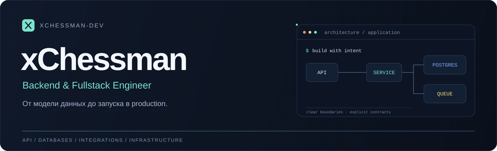

  

  
  

## О работе

Backend и fullstack-разработчик. Разрабатываю веб-приложения, CRM-системы, личные кабинеты и интеграции. Беру задачу целиком: от модели данных и API до интерфейса, развёртывания и дальнейшего развития.

Основной фокус — **PHP / Laravel, PostgreSQL и Redis**. Для веб-интерфейсов использую **React и Vue**, для приложений — **C# / .NET, React Native и Kotlin**. Отдельное направление — инструменты для работы со звуком, локальными моделями и автоматизацией.

## Стек

**Backend**

  
  
  
  

**Данные**

  
  
  

**Веб-интерфейсы**

  
  
  

**Инфраструктура**

  
  
  
  

**Desktop и mobile**

  
  
  
  
  

## Инженерный подход

- **Архитектура под задачу.** Определяю границы модулей, контракты API и правила работы с данными до того, как система начинает обрастать интеграциями.
- **Предсказуемое поведение.** Продумываю права доступа, валидацию, очереди, повторные запросы и обработку ошибок внешних сервисов.
- **Поддержка после запуска.** Проверяю критические сценарии тестами, сохраняю миграции и инструкции, настраиваю воспроизводимое развёртывание.

## Открытые проекты

Часть моего кода — инструменты для повседневной работы, Windows и Android.

<table>
  <tr>
    <td width="50%" valign="top">
      <h3><a href="https://github.com/xChessman-dev/absolut-video">Абсолют видео ↗</a></h3>
      
Офлайн-видеолента из галереи Android: свайпы, избранное, перемотка и сохранение позиции.

      
<code>React Native</code> <code>Expo</code> <code>TypeScript</code>

    </td>
    <td width="50%" valign="top">
      <h3><a href="https://github.com/xChessman-dev/TypePilot">TypePilot ↗</a></h3>
      
Помощник ввода для Windows: исправления, подсказки слов и переработка текста по запросу.

      
<code>C#</code> <code>.NET</code> <code>WPF</code>

    </td>
  </tr>
  <tr>
    <td width="50%" valign="top">
      <h3><a href="https://github.com/xChessman-dev/MicPilot">MicPilot ↗</a></h3>
      
Обработка микрофона: шумоподавление, эквалайзер, динамика и подбор настроек по записи.

      
<code>C#</code> <code>WPF</code> <code>DSP</code>

    </td>
    <td width="50%" valign="top">
      <h3><a href="https://github.com/xChessman-dev/GlucoDay">GlucoDay ↗</a></h3>
      
Личный дневник для Android: сахар, питание, вес и активность с локальным хранением данных.

      
<code>Kotlin</code> <code>Jetpack Compose</code> <code>Room</code>

    </td>
  </tr>
</table>

Ещё: [StreamCensor](https://github.com/xChessman-dev/StreamCensor) · [VoiceBridge](https://github.com/xChessman-dev/VoiceBridge) · [VoiceMorph](https://github.com/xChessman-dev/VoiceMorph).

 

> Сижу на Linux, пишу backend, люблю блондинок

 

**Есть задача по backend, интеграциям или разработке продукта?**
Напиши в [Telegram](https://t.me/xchessman) — обсудим требования, объём и подход к реализации.
